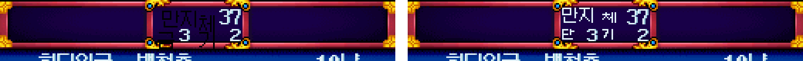

# v3.5 패치 내역 (이슈 #1 대응)

결과 롬 MD5: `2b96375ecfa39193efeed111f2ffb02e` · 패치: `dist/Tengai_Makyou_II_KR_v3.5.xdelta`

| # | 증상 | 원인 | 수정 |
|---|------|------|------|
| 1 | 전투 「卍답의 공격!!」, 장비 헤더 끝 「卍」 | arm9 전투 이름표 `卍丸`(0x0D30AC) 미번역 → 한글 슬롯에 덮인 丸이 「답」으로 표시 | `만지`로 번역 추가 |
| 2 | 필드 상태창 이름·체·기 겹침 / 전투 얼굴 패널 체·기 판독 곤란 | v3.4에서 mainmenu.obc(타일 520–567)·bs_obj_name_p1–4를 16×16 중앙 글자·검정(팔레트 1)으로 다시 그림 | v3.3에서 검증된 원래 배치·흰색(팔레트 2) 타일로 복원 |
| 3 | 오프닝 스태프 크레딧 회색 패널 | BG 재압축 시 불투명 패널 타일이 타일 0번에 들어감(게임은 타일 0을 투명으로 그림) | `repack_bg`가 원본 앞쪽 타일을 고정(seed). 크레딧 7종·선택화면 12629·세이브 9202·타이틀 동일 처리 |
| 4 | 전투 무구/도구 헤더, 아이템·상점 설명 아래 줄 깨짐 | 아이템 '읽기' 문자열(원본 가타카나)을 그리는 반각 렌더러가 가나·전각 영문만 지원 → 한글은 쓰레기 글자 | 읽기 문자열 116개를 빈 문자열로(`clear` 플래그 신설) |
| 5 | 도구·상점 화면 「깨진 이미지」 | 사용/구입/판매/보관/찾기/버림 버튼 타일 648–719가 검정 잉크 | v3.3 흰색 타일로 복원 |
| 6 | 일부 미번역 | 오버레이 0의 대상 선택(「卍丸は誰を？」 등), 絹 약칭, 상태이상 8종, 逃水/逃水の杖 | 18개 항목 번역 추가 |

검증: py-desmume 헤드리스 에뮬레이터로 새 게임 시작 → 필드 메뉴·도구 화면 확인, 크레딧/선택/세이브 BG 타일 0이 원본과 일치함을 확인, `tools/check_rules.py` 위반 0.
